<div align="center">

# InfoSEO · اینفو سئو

**مجموعهٔ ابزارهای رایگان فارسی برای سئو و وبمستری — بدون ثبت‌نام، سریع و راست‌به‌چپ از ریشه**

[🌐 infoseo.ir](https://infoseo.ir/) · [🤖 ربات بله](https://ble.ir/infoseobot) · [✈️ ربات تلگرام](https://t.me/infoseo_irbot) · [🧰 همهٔ ابزارها](https://infoseo.ir/services/) · [📖 فهرست کامل](docs/TOOLS.md) · [🏗 ساختار سایت](docs/STRUCTURE.md)


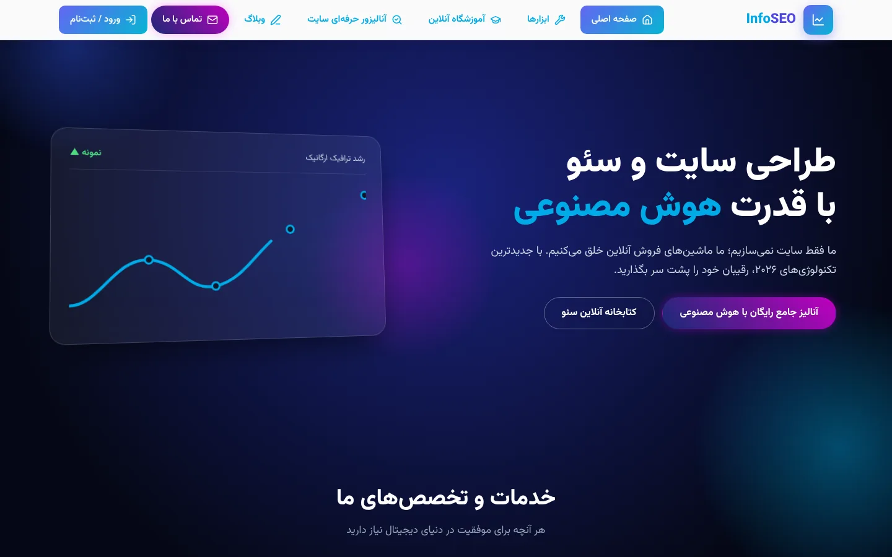

</div>

---

## ✨ اینفو سئو چیست؟

وقتی می‌خواهید سایتتان را بررسی کنید، معمولاً باید بین ده‌ها سایت خارجی با رابط انگلیسی و تبلیغات رفت‌وآمد کنید.
**اینفو سئو همهٔ این ابزارها را یک‌جا و به زبان فارسی** در اختیارتان می‌گذارد: از شمارندهٔ کلمات و ساخت متا تگ تا بررسی DNS، SSL، سرعت و اعتبار دامنه.

- 🧰 **۶۹ ابزار** در ۸ دسته: سئو و محتوا، تحلیل سایت، دامنه و DNS، سرعت، توسعه، امنیت، تصویر و رنگ، محاسبه‌گرها
- 🔒 **۲۹ ابزار کاملاً در مرورگر شما اجرا می‌شوند**؛ متنی که وارد می‌کنید هرگز به سرور ارسال نمی‌شود
- 🆓 استفادهٔ رایگان و بدون ثبت‌نام
- 📱 طراحی موبایل‌محور و RTL واقعی (نیم‌فاصله، ارقام فارسی، فونت وزیرمتن)
- ⚡ بدون فریم‌ورک سنگین فرانت‌اند؛ PHP + جاوااسکریپت ساده

## 🤖 ابزارها را در پیام‌رسان هم داشته باشید

لازم نیست هر بار سایت را باز کنید. همهٔ ابزارها در **بله** و **تلگرام** هم در دسترس‌اند:

| پیام‌رسان | ربات | لینک |
|---|---|---|
| **بله** | `@infoseobot` | [ble.ir/infoseobot](https://ble.ir/infoseobot) |
| **تلگرام** | `@infoseo_irbot` | [t.me/infoseo_irbot](https://t.me/infoseo_irbot) |

با `/start` شروع کنید و دسته یا ابزار مورد نظر را بزنید.

- 🧰 **همهٔ ابزارهای سایت** با همان دسته‌بندی، جستجو و صفحه‌بندی؛ ابزار تازه‌ای که به سایت اضافه شود خودکار در ربات هم می‌آید (با نشان 🆕)
- 💬 **مرحله‌به‌مرحله**: ربات فیلدهای هر ابزار را یکی‌یکی می‌پرسد؛ برای انتخاب‌ها دکمه می‌گذارد و فیلدهای اختیاری را می‌شود رد کرد
- 🌐 ابزارهای سمت‌سرور (DNS، WHOIS، SSL، سرعت، هدرها و …) با همان کد و محافظ‌های امنیتی سایت اجرا می‌شوند؛ چند ابزار متنی ساده مثل شمارندهٔ کلمات و تولید رمز مستقیم در ربات جواب می‌دهند
- 🔗 **حساب یکی است**: ربات را با همان حساب سایت (شمارهٔ موبایل) وصل می‌کنید؛ اعتبار و دسترسی‌ها مشترک است
- 💎 ابزارهای پولی: هزینه را نشان می‌دهد، **تأیید صریح** می‌گیرد و اگر سرویس خطا بدهد اعتبار را برمی‌گرداند؛ خرید اعتبار هم از داخل ربات ممکن است
- 🔐 ورود به سایت با یک لینک یک‌بارمصرف از ربات

## 🖼 نگاهی به ابزارها

| | |
|---|---|
| 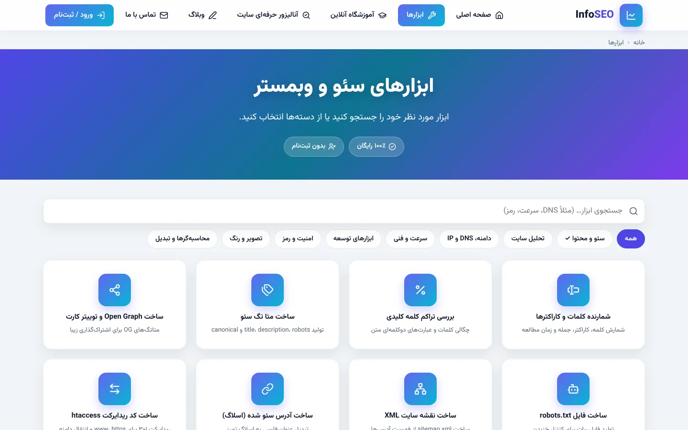<br>**فهرست ابزارها** با جستجو و دسته‌بندی | 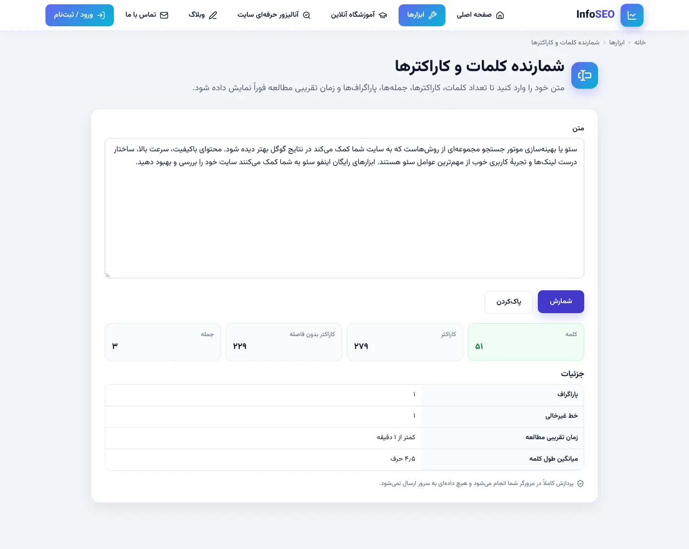<br>**شمارندهٔ کلمات** (فارسی و انگلیسی) |
| 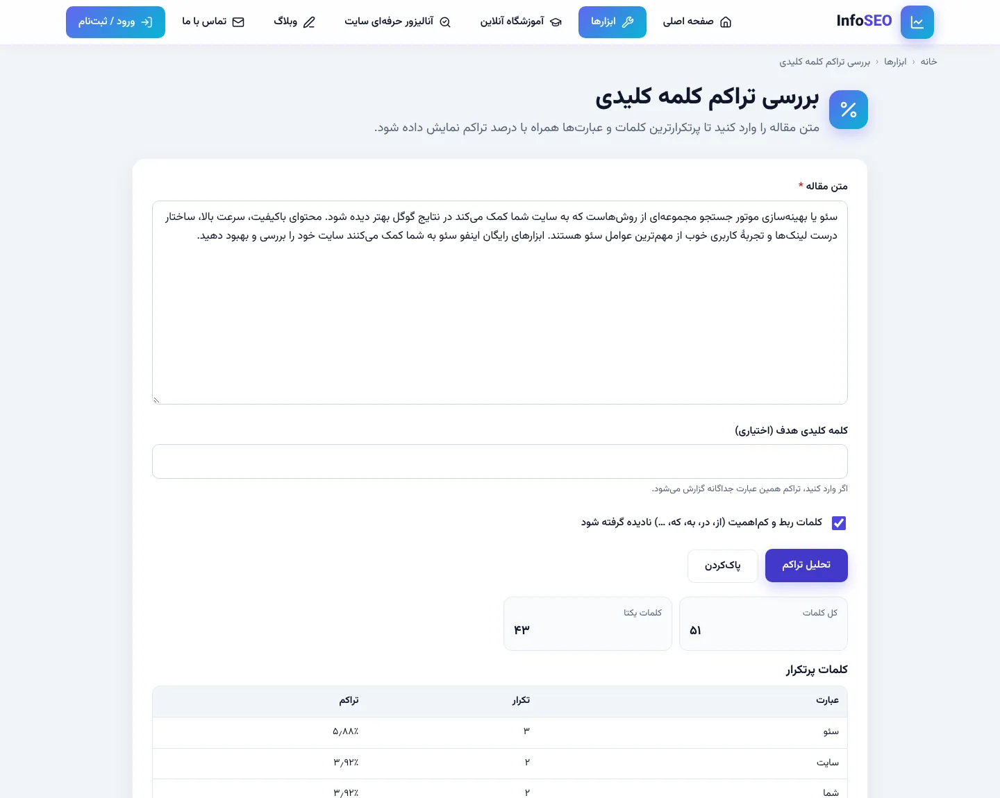<br>**تراکم کلمه کلیدی** با حذف کلمات ربط فارسی | 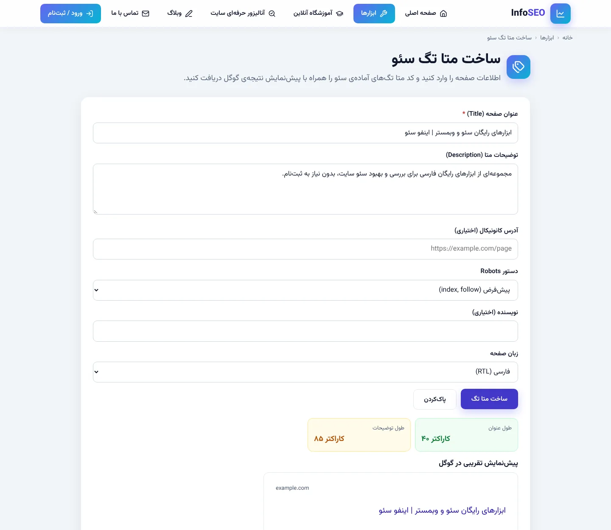<br>**ساخت متا تگ** با پیش‌نمایش نتیجهٔ گوگل |
| 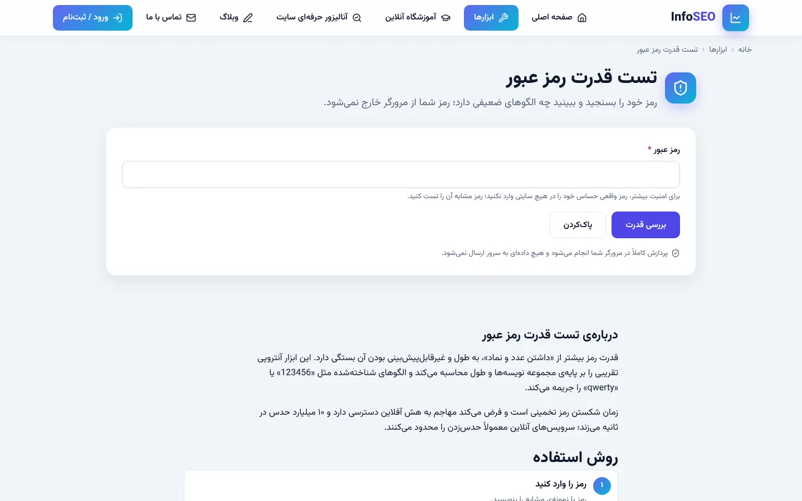<br>**تست قدرت رمز عبور** | 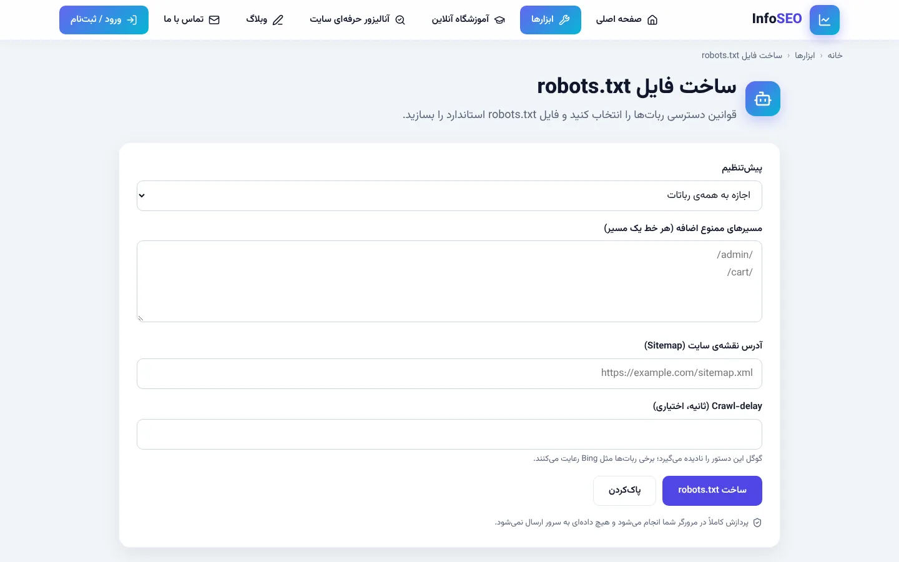<br>**ساخت robots.txt** |
| 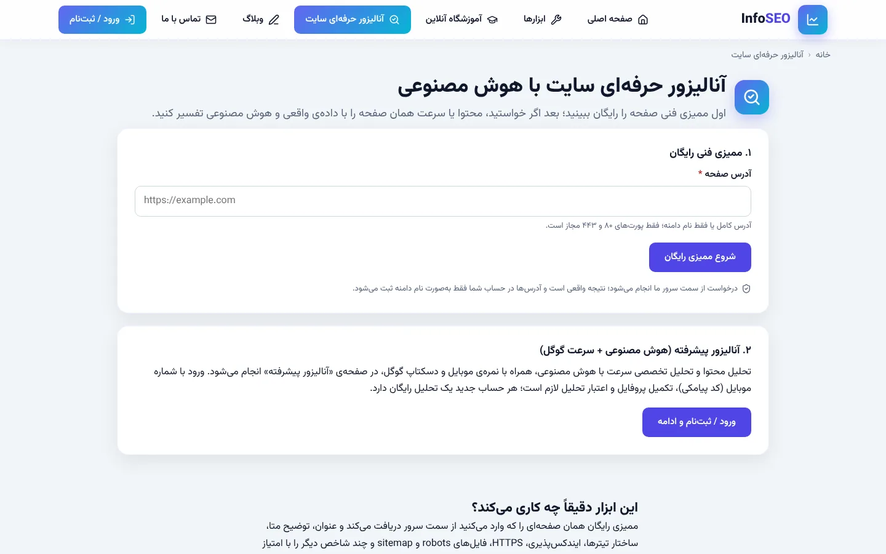<br>**آنالیزور حرفه‌ای** (PageSpeed + هوش مصنوعی) | 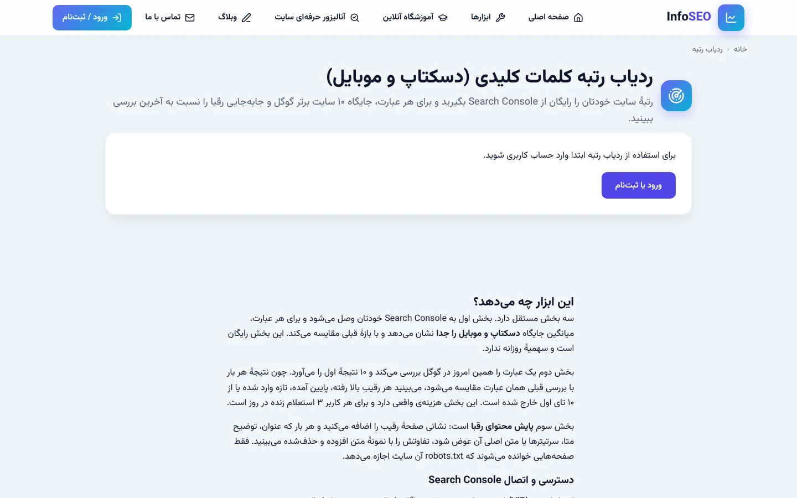<br>**ردیاب رتبه** (Search Console و رتبهٔ زنده) |

<details>
<summary>📱 نسخهٔ موبایل</summary>
<br>
<p align="center">
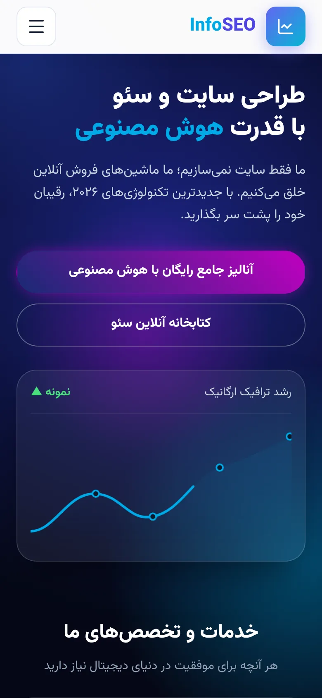
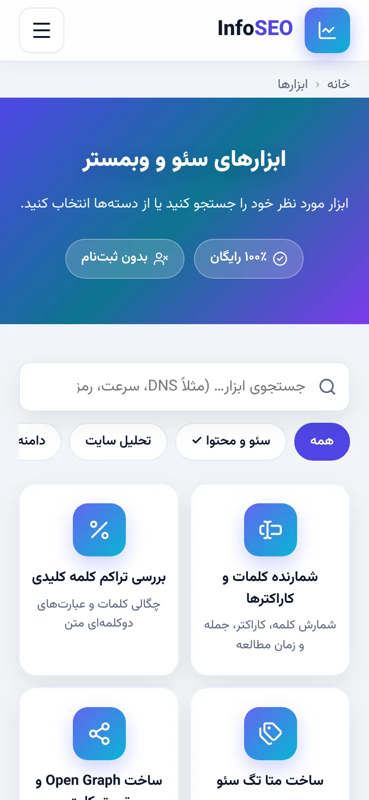
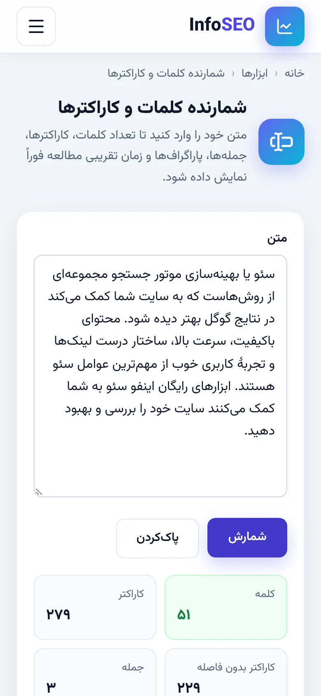
</p>
</details>

> اسکرین‌شات‌ها از یک محیط آزمایشی محلی گرفته شده‌اند. متن نمونه برای ابزارها را خودم وارد کرده‌ام. نمودار «نمونه» در صفحهٔ اصلی هم یک گرافیک تزئینی است، نه داده‌ی واقعی.

## 🧰 ابزارهای شاخص

| دسته | نمونه‌ها |
|---|---|
| سئو و محتوا | شمارندهٔ کلمات، تراکم کلمه کلیدی، متا تگ، Open Graph، robots.txt، نقشهٔ XML، ریدایرکت htaccess |
| تحلیل سایت | تحلیل متا تگ‌ها، شمارش لینک‌ها، لینک‌های شکسته، شبیه‌ساز عنکبوت موتور جستجو، تشخیص فناوری (BuiltWith)، اعتبار دامنه |
| دامنه و DNS | DNS، intoDNS، WHOIS، سن دامنه، IP و GeoIP، Reverse IP، کلاس C |
| سرعت و فنی | PageSpeed، هدرهای HTTP، فشرده‌سازی GZIP، حجم صفحه، وضعیت سرور، Ping |
| امنیت | بررسی SSL، لیست سیاه، بدافزار (Google Safe Browsing)، سازندهٔ رمز، MD5 |
| توسعه / تصویر | کوچک‌ساز CSS/JS/HTML، مقایسهٔ کد، رمزگذاری URL، QR، رنگ، بهینه‌ساز تصویر، فاوآیکن |

فهرست کامل و دقیق: **[docs/TOOLS.md](docs/TOOLS.md)**

## 🧩 فقط ابزار نیست

اینفو سئو یک **CMS سبک** هم هست که خودمان نوشته‌ایم:

- ✍️ **بلاگ** با ویرایشگر بصری فارسی، پنل سئو شبیه Yoast (سازگار با فارسی)، زمان‌بندی انتشار و نسخه‌های قبلی
- 🧱 **صفحه‌ساز** ویجتی و بلوک‌های سراسری
- 👤 **حساب کاربری** با ورود پیامکی (OTP)، اعتبار و پرداخت آنلاین
- 🤖 **آنالیزور هوشمند**: ترکیب PageSpeed و هوش مصنوعی برای گزارش فارسی
- 📈 **ردیاب رتبه** (با دعوت): رتبهٔ دسکتاپ/موبایل از Search Console، رتبهٔ زنده و حرکت رقبا، و پایش تغییر محتوای صفحهٔ رقبا
- 🤖 **ربات بله و تلگرام** که همان ابزارها و همان حساب را در پیام‌رسان می‌آورد
- 🛡 **پنل مدیریت** با ورود دومرحله‌ای (TOTP)، گزارش رویدادها و مدیریت ماژول‌ها

## 🏗 معماری در یک نگاه

```
مرورگر ──► index.php (front controller) ──► Router ──► Controller ──► View (SSR)
                                              │
                       ┌──────────────────────┼───────────────────────┐
                  ابزار مرورگری           ابزار سمت‌سرور           CMS / حساب / پنل
               assets/js/tools/*.js    POST /api/v1/{slug}        بلاگ، صفحه‌ساز، ادمین
                (بدون ارسال داده)      Fetcher امن (ضد SSRF)
                                               ▲
                              ربات بله و تلگرام (webhook) ── همان ابزارها، همان حساب
```

- **رندر سمت سرور**: عنوان، توضیح، canonical، breadcrumb و JSON-LD همه در HTML اولیه‌اند؛ جاوااسکریپت فقط تعامل می‌افزاید.
- **ابزارها داده‌اند، نه صفحه**: هر ابزار یک فایل تعریف (`app/Tools/defs/*.php`) است؛ صفحه، SEO، FAQ، ابزارهای مرتبط و نقشهٔ سایت از همان ساخته می‌شود.
- **ضد SSRF**: هر درخواست خروجی از یک کلاینت امن می‌گذرد: فقط http/https، پورت‌های محدود، اعتبارسنجی IP پس از DNS و پس از هر ریدایرکت، سقف حجم و زمان.
- **اسرار رمزنگاری‌شده**: کلیدهای API با AES-256-GCM در دیتابیس ذخیره می‌شوند و هرگز دوباره نمایش داده نمی‌شوند.

جزئیات بیشتر: **[docs/STRUCTURE.md](docs/STRUCTURE.md)**

## 📂 این مخزن چه چیزی دارد؟

این مخزن **عمومی** است و فقط بخش‌های قابل‌نمایش پروژه را دارد:

| مسیر | محتوا |
|---|---|
| [`code/client-tools/`](code/client-tools) | جاوااسکریپت ۲۹ ابزار مرورگری (بدون وابستگی خارجی) |
| [`code/tool-definitions/`](code/tool-definitions) | تعریف همان ابزارها (عنوان، متن راهنما، FAQ، فیلدها) به‌صورت آرایهٔ PHP |
| [`code/frontend/`](code/frontend) | هستهٔ ابزارها (`tk.js`) و استایل اصلی (`app.css`) |
| [`docs/`](docs) | فهرست ابزارها، ساختار سایت، اسکرین‌شات‌ها |

> کد کامل سایت (پنل مدیریت، حساب کاربری، پرداخت، ردیاب رتبه، ربات و …) در مخزن خصوصی نگهداری می‌شود.

## 🧪 کیفیت و صداقت دربارهٔ آزمون‌ها

- آزمون‌های خودکار روی محیط آزمایشی محلی (PHP + MariaDB، بدون اینترنت و با شبیه‌ساز سرویس‌های بیرونی) اجرا شده‌اند و Lighthouse محلی روی صفحات اصلی ۱۰۰ در چهار شاخص بوده است. این عددهای آزمایشگاهی‌اند، نه داده‌ی میدانی کاربران.
- ارتباط با سرویس‌های واقعی (پیامک، پرداخت، هوش مصنوعی، Google و …) در محیط آزمایشی انجام نشد؛ آن بخش‌ها فقط با شبیه‌ساز تست شده‌اند.
- «۱۰۰ درصد امن» وجود ندارد؛ طراحی عمداً سطح حمله را کوچک نگه می‌دارد (بدون افزونهٔ ثالث، کوئری‌های پارامتری، پاک‌سازی ورودی و خروجی) ولی امنیت واقعی به نگهداری مداوم هم وابسته است.

## 📄 مجوز

همهٔ حقوق برای InfoSEO محفوظ است. کدها برای مشاهده و یادگیری منتشر شده‌اند و تا زمانی که مجوز صریح اضافه نشود، حق استفاده یا بازنشر ندارند.
